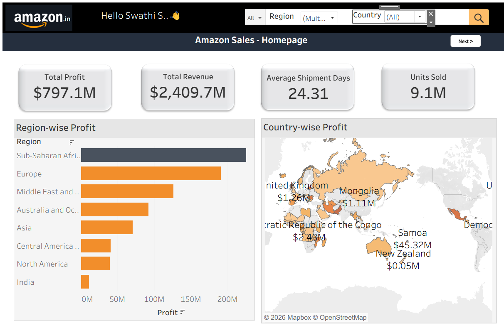
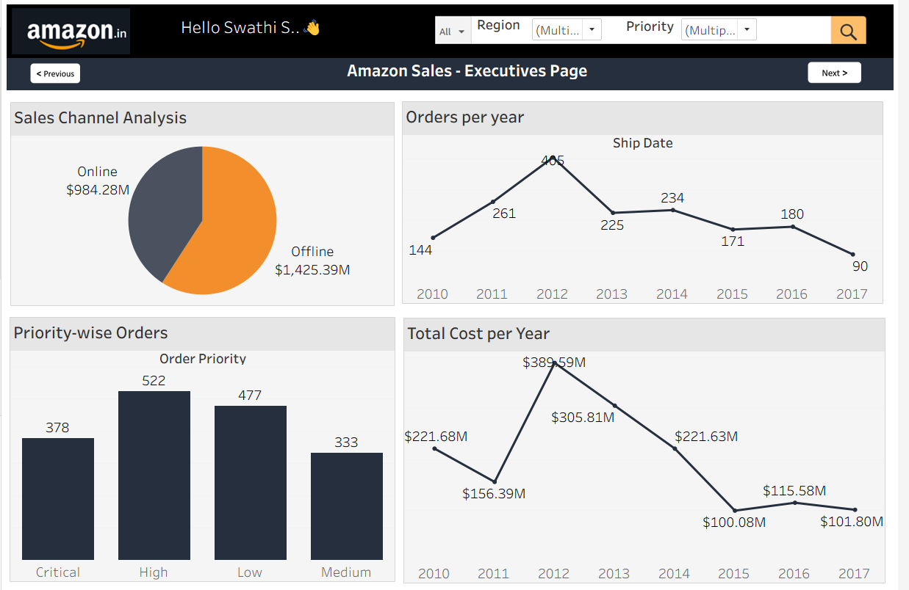
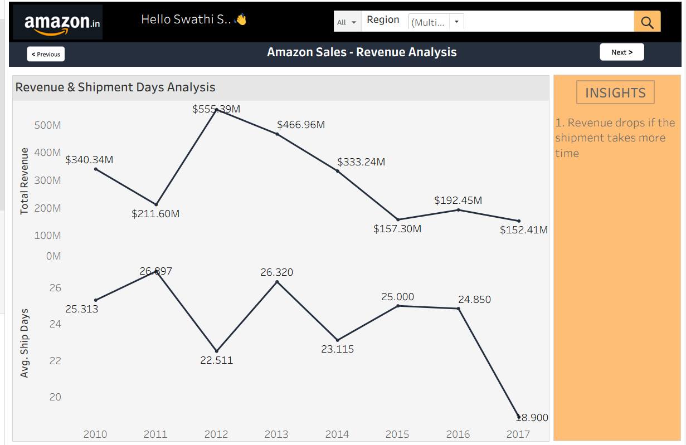
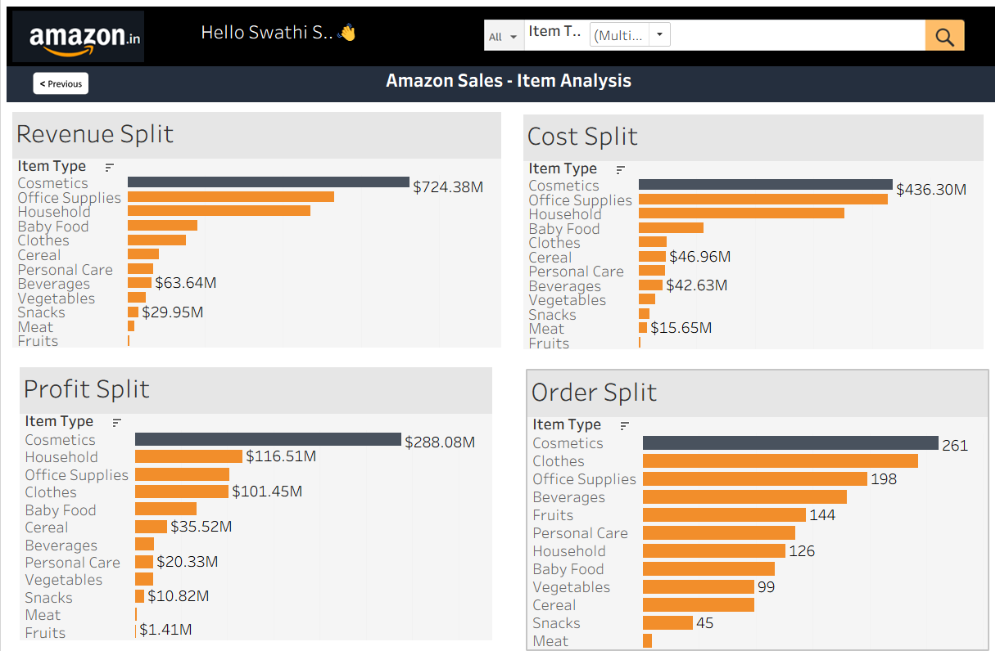

<div align="center">

# Amazon Sales Analytics Dashboard

**An interactive, multi-page Tableau dashboard that turns raw sales records into clear, actionable business insights.**


</div>

---

## Table of Contents

- [Overview](#overview)
- [Business Objectives](#business-objectives)
- [Dashboard Preview](#dashboard-preview)
- [Dashboard Walkthrough](#dashboard-walkthrough)
- [Key Insights](#key-insights)
- [Recommendations](#recommendations)
- [Dataset](#dataset)
- [Tools & Technologies](#tools--technologies)
- [Project Structure](#project-structure)
- [Getting Started](#getting-started)
- [Future Enhancements](#future-enhancements)
- [License](#license)

---

## Overview

This project presents an end-to-end **sales performance analysis** built in **Tableau**. The dashboard is organised as a four-page guided story, moving from a high-level company snapshot to executive-level trends, then to revenue and fulfilment analysis, and finally to product-level performance.

Each page includes interactive filters (Region, Country, Order Priority, Item Type) and page-to-page navigation buttons, so stakeholders can explore the data without any technical background.

### Headline Metrics

| Metric | Value |
|---|---|
| **Total Revenue** | $2,409.7M |
| **Total Profit** | $797.1M |
| **Overall Profit Margin** | ~33.1% |
| **Units Sold** | 9.1M |
| **Average Shipment Days** | 24.31 |

---

## Business Objectives

- Monitor overall **revenue, cost, and profitability** at a glance.
- Identify the **highest and lowest performing regions and countries**.
- Compare **online vs. offline** sales channel contribution.
- Track **order volume and cost trends** from 2010 to 2017.
- Evaluate the relationship between **shipment time and revenue**.
- Determine which **product categories** drive revenue, cost, profit, and order volume.

---

## Dashboard Preview


> **Note:** Place your screenshots in an `images/` folder and keep the file names below (or update the paths).

| Page 1 – Homepage | Page 2 – Executives Page |
|:---:|:---:|
|  |  |
 
| Page 3 – Revenue Analysis | Page 4 – Item Analysis |
|:---:|:---:|
|  |  |

---

## Dashboard Walkthrough

### 1. Homepage – Company Snapshot
A summary view with four KPI cards (Total Profit, Total Revenue, Average Shipment Days, Units Sold).

- **Region-wise Profit:** Ranked bar chart comparing profit across all regions.
- **Country-wise Profit:** Interactive geographic map with profit by country.
- **Filters:** Region and Country.

### 2. Executives Page – Strategic Overview
Designed for leadership-level decision making.

- **Sales Channel Analysis:** Online vs. Offline revenue split.
- **Orders per Year:** Order volume trend from 2010 to 2017.
- **Priority-wise Orders:** Distribution across Critical, High, Medium, and Low priorities.
- **Total Cost per Year:** Annual cost trend.
- **Filters:** Region and Order Priority.

### 3. Revenue Analysis – Revenue vs. Shipment Time
A dual-axis view comparing **Total Revenue** and **Average Shipping Days** by year, with a dedicated insights panel.

- **Filter:** Region.

### 4. Item Analysis – Product Performance
Four ranked bar charts comparing every item type:

- **Revenue Split**
- **Cost Split**
- **Profit Split**
- **Order Split**
- **Filter:** Item Type.

---

## Key Insights

### Financial Performance
- The business generated **$2,409.7M in revenue** against **$1,612.6M in total cost**, resulting in **$797.1M profit** (~33% margin).
- **Revenue peaked in 2012 at $555.39M** and declined to **$152.41M by 2017**.
- **Total cost peaked in 2012 at $389.59M** and fell to roughly **$101.80M by 2017**, tracking the decline in revenue.

### Sales Channel
- **Offline sales lead with $1,425.39M (~59%)**, compared with **$984.28M (~41%)** for online.

### Orders & Priority
- Order volume rose from **144 (2010)** to a peak of **405 (2012)**, then trended down to **90 in 2017**.
- **High-priority orders are the largest group (522)**, followed by Low (477), Critical (378), and Medium (333).

### Regional Performance
- **Sub-Saharan Africa** is the most profitable region, followed by **Europe** and **Middle East & North Africa**.
- **India** and **North America** contribute the lowest profit.

### Shipment & Revenue
- Average shipping time ranged from **18.9 to 26.9 days** over the period.
- The strongest revenue year (2012) coincided with one of the shortest average shipping times (**22.5 days**), supporting the dashboard's finding that delivery speed is linked to revenue performance.

### Product Performance
- **Cosmetics is the clear leader** across every measure: **$724.38M revenue, $436.30M cost, $288.08M profit, and 261 orders**.
- **Household ($116.51M)** and **Clothes ($101.45M)** follow in profit contribution.
- **Fruits, Meat, and Snacks** are the lowest-contributing categories by profit.

---

## Recommendations

1. **Prioritise Cosmetics** – It drives the largest share of revenue and profit; protect supply, inventory, and marketing investment here.
2. **Reduce shipment times** – Faster fulfilment is associated with stronger revenue periods; review logistics in slower-shipping periods and regions.
3. **Strengthen the online channel** – Online trails offline by roughly $441M, which indicates room for growth.
4. **Investigate the post-2012 decline** – Orders, revenue, and cost all fell sharply; a root-cause analysis (demand, pricing, market changes) is recommended.
5. **Review low-margin categories** – Evaluate whether low-profit items (e.g., Fruits, Meat, Snacks) justify their operational cost.
6. **Expand in high-profit regions** – Double down on Sub-Saharan Africa and Europe while building a targeted growth plan for India and North America.

---

## Dataset

The analysis is based on a sales records dataset containing order-level transactions.

| Field | Description |
|---|---|
| Region / Country | Geographic location of the sale |
| Item Type | Product category |
| Sales Channel | Online or Offline |
| Order Priority | Critical, High, Medium, Low |
| Order Date / Ship Date | Order and shipment dates |
| Units Sold | Quantity sold |
| Unit Price / Unit Cost | Price and cost per unit |
| Total Revenue / Total Cost / Total Profit | Calculated financial measures |

> **Data source:** _Add the dataset link or description here (e.g., Kaggle, internal export)._

---

## Tools & Technologies

| Category | Tool |
|---|---|
| Visualization & BI | Tableau |
| Mapping | Tableau Maps (Mapbox / OpenStreetMap) |
| Data Preparation | Excel / CSV |
| Version Control | Git & GitHub |

### Tableau Features Used
Calculated fields, interactive filters, dashboard actions, page navigation buttons, dual-axis charts, geographic maps, sorted bar charts, and custom KPI cards.

---

## Project Structure

```
amazon-sales-dashboard/
│
├── data/
│   └── amazon_sales.csv
│
├── images/
│   ├── 01_homepage.png
│   ├── 02_executives_page.png
│   ├── 03_revenue_analysis.png
│   └── 04_item_analysis.png
│
├── Amazon_Sales_Dashboard.twbx
└── README.md
```

---

## Getting Started

1. **Clone the repository**
   ```bash
   git clone https://github.com/<swathi284>/Amazon-Sales-Analysis-Dashboard.git
   ```
2. **Open the workbook** `Amazon_Sales_Dashboard.twbx` in **Tableau Desktop** or **Tableau Public**.
3. **Explore the dashboard** using the filters and the *Previous / Next* buttons to navigate between pages.

> **Live dashboard:** _Add your Tableau Public link here._

---

## Future Enhancements

- Add **forecasting** to project revenue and order trends.
- Include **year-over-year growth** and profit margin KPIs.
- Add **customer segmentation** and **delivery performance** analysis.
- Build a **mobile-optimised** dashboard layout.
- Automate data refresh through a live database connection.

---

## License

This project is licensed under the [MIT License](LICENSE).

---

<div align="center">

If you found this project useful, please consider giving it a star.

</div>
